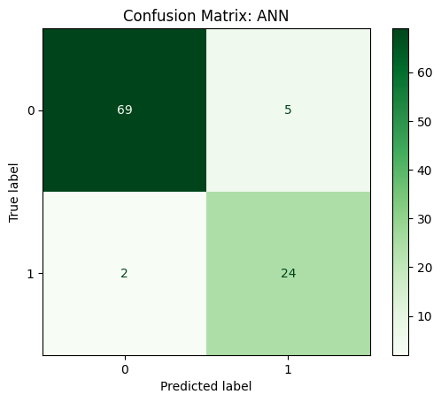

# Metal Parts Durability

Lifespan prediction and usability classification using regression and neural-network models. MSc machine learning coursework, University of Greenwich.

## Problem

Can production attributes, chemical composition and defect counts help predict a metal part's lifespan and classify usability against a lifespan threshold of 1,500?

## Approach

- Explored distributions, correlations and outliers in the supplied manufacturing dataset.
- Prepared features and compared linear regression with an artificial neural network for lifespan prediction.
- Compared logistic regression with a neural network for usability classification.
- Used train/test evaluation, hyperparameter search, regression metrics and confusion matrices to examine performance and errors.

## Reported results

The coursework reports approximately **R² = 0.92** for the neural-network lifespan model and **93% classification accuracy** for the neural-network usability model. R² describes explained variation; it is not a regression 'accuracy' percentage.

These results describe the academic evaluation in the report, not a deployed quality-control system. Model errors and the cost of misclassification remain important considerations for any practical use.

## Explore the work

- [Portfolio report](portfolio-report.pdf).
- [Original notebook](COMP1801MachineLearningCoursework.ipynb).
- [Dataset](COMP1801_Coursework_Dataset.csv).
- [Notebook export as PDF](COMP1801MachineLearningCoursework%20Code.pdf).

## Run or inspect

The original submitted notebook and saved outputs remain available above. For local use, [analysis-local.ipynb](analysis-local.ipynb) loads the CSVs from the repository root and has cleared outputs.

1. Download or clone the complete repository.
2. Create a separate Python 3.11 environment.
3. From the repository root, run `python -m pip install -r requirements.txt`, then `python -m jupyter lab`.
4. Open `analysis-local.ipynb` with that environment's Python kernel and run cells in order.

The portable copy changes only input paths and inline installation cells. Model settings and analytical methods are preserved. Code cells passed syntax checks, and the notebook source was matched to the submitted GitHub version before adaptation. A fresh end-to-end analysis and clean-environment dependency installation have not been verified. Library changes, training time and original analytical limitations can affect reproduction.

## Context

Academic project by Tejesh Ramesh Bawa. The preview comes from the report, and the portfolio copy omits the student identifier.
